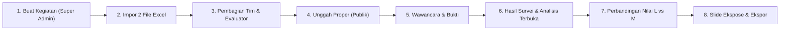

# Dokumentasi Fitur: Sistem Evaluasi Pasca Pelatihan (BPSDM Provinsi Jawa Barat)

Dokumen ini merangkum seluruh fitur yang tersedia pada aplikasi **Sistem Evaluasi Pasca Pelatihan** (PKP, PKA, dan PKN), lengkap dengan peran pengguna, cara kerja setiap modul, aturan perhitungan resmi, serta perlindungan privasi data.

---

## 1. Gambaran Umum & Alur Kerja Sistem

Sistem ini mengelola siklus evaluasi pasca pelatihan secara terpusat mulai dari pembuatan kegiatan, impor berkas survei dan form wawancara Excel, pengumpulan bukti Aksi Perubahan (*Proper*) dari peserta melalui tautan publik, penilaian wawancara per tim evaluator, analisis kuesioner dan komparasi skor, hingga penyusunan materi paparan **Slide Ekspose** (web, PDF, CSV, dan PowerPoint `.pptx`).

---

## 2. Peran Pengguna & Hak Akses

Sistem membedakan akses menjadi tiga kelompok pengguna dengan batas kewenangan yang ditegakkan di sisi server (*middleware* dan API):

| Peran | Metode Akses | Cakupan Kewenangan |
| :--- | :--- | :--- |
| **Super Admin** | Login menggunakan **Email + Kata Sandi** (`/login`) | Mengelola akun Evaluator, membuat/mengubah/menghapus Kegiatan, mengimpor file Excel, mengatur pembagian tim & tautan *meeting*, memantau progres seluruh tim, meninjau hasil survei & perbandingan, menyusun pembahasan AI, serta mengunduh materi Ekspose. |
| **Evaluator** | Login menggunakan **NIP / Username + Kata Sandi** (`/login`) | Wajib mengganti kata sandi awal atau sandi hasil *reset* saat login pertama (`/ganti-sandi`). Hanya dapat melihat dan menilai daftar peserta yang tergabung di dalam tim yang diampunya (`/kegiatan/[id]/wawancara`). |
| **Peserta / Alumni** | Tanpa login melalui **Tautan Publik** (`/unggah-inovasi` atau `/pasca-pelatihan/unggah-inovasi`) | Memilih kegiatan aktif, memverifikasi identitas menggunakan NIP/NIK, lalu mengunggah laporan Aksi Perubahan (*Proper*) beserta foto bukti capaian jangka menengah dan jangka panjang. |

---

## 3. Rincian Fitur Utama

### 3.1 Autentikasi, Sesi Cookie, dan Wajib Ganti Sandi
- **Rute Terkait:** `/login`, `/ganti-sandi`, `/api/auth/*`
- **Penjelasan Fitur:**
  - Mendukung satu kolom identitas terpadu di halaman masuk: email untuk Super Admin, atau NIP/username untuk Evaluator.
  - Sesi disimpan dalam token JWT bertanda tangan (`jose`) di dalam *HTTP-only cookie* sehingga aman dari pembacaan skrip sisi klien.
  - Akun Evaluator yang baru dibuat otomatis memiliki status `mustChangePassword = true`. Saat login pertama kali (atau setelah di-*reset* Super Admin), pengguna diarahkan otomatis ke halaman `/ganti-sandi` sebelum dapat membuka menu kegiatan.
  - Mendukung pengalihan tema tampilan terang (*Light Mode*) dan gelap (*Dark Mode*) dengan palet monokrom kontras tinggi.

### 3.2 Manajemen Akun Evaluator
- **Rute Terkait:** `/pengguna`, `/api/users/*`
- **Penjelasan Fitur:**
  - Super Admin dapat menambah akun Evaluator baru secara manual, menyunting nama/NIP/email, melihat daftar tim dan kegiatan yang sedang diampu tiap Evaluator, serta menonaktifkan atau mengaktifkan kembali akun.
  - Tersedia fitur salin kata sandi awal terenkripsi (*vault password*) dan fitur **Reset Kata Sandi** apabila Evaluator lupa kredensialnya.

### 3.3 Manajemen Multi-Kegiatan Evaluasi
- **Rute Terkait:** `/kegiatan`, `/api/kegiatan`
- **Penjelasan Fitur:**
  - Setiap pelaksanaan evaluasi (contoh: *PKP Angkatan VII Kabupaten Bogor*) diisolasi di dalam wadah **Kegiatan** tersendiri sehingga data antarangkatan atau antarjenis pelatihan (`PKP`, `PKA`, `PKN`) tidak saling bercampur.
  - Super Admin membuat kegiatan dengan lima atribut: Nama Kegiatan, Jenis Pelatihan, Penyelenggara, Lokasi, serta Tanggal Mulai dan Tanggal Selesai.
  - Bagi Evaluator, daftar kegiatan hanya menampilkan kegiatan di mana Evaluator tersebut ditugaskan pada minimal satu tim.

### 3.4 Dasbor Ringkasan Kegiatan & Panduan Alur 8 Tahap
- **Rute Terkait:** `/kegiatan/[id]`
- **Penjelasan Fitur:**
  - Menampilkan daftar periksa (*workflow checklist*) 8 tahap pelaksanaan evaluasi dari hulu ke hilir.
  - Menyajikan 4 kartu statistik utama (total peserta, rata-rata Survei `L`, rata-rata Wawancara `M`, serta selisih rata-rata `M - L`), ringkasan kelengkapan data, daftar selisih terbesar positif/negatif, serta pratinjau 5 grafik ekspose.
  - Menampilkan panel peringatan otomatis bila terdapat peserta dengan nilai kosong (`KOSONG`) atau bila terdeteksi selisih angka antara berkas Excel `Form Penilaian` dan lembar `ekspose`.

### 3.5 Impor Cerdas Dua File Excel & Pencatatan Selisih Antarberkas
- **Rute Terkait:** `/kegiatan/[id]/input-data`, `/api/peserta/import`
- **Penjelasan Fitur:**
  - Menerima unggahan 1 atau 2 berkas Excel sekaligus: **Berkas Olah Data Survei** (wajib, sebagai data induk peserta & kuesioner) dan **Berkas Form Penilaian Wawancara** (opsional, berisi 30+ lembar penilaian individu).
  - **Deteksi & Tukar Otomatis (*Auto-Detect & Auto-Swap*):** Sistem mengenali struktur *sheet* kedua berkas secara otomatis walaupun urutan pengunggahannya tertukar, serta menolak jika kedua file sama-sama terdeteksi sebagai file survei atau sama-sama file wawancara.
  - **Ekstraksi Kuesioner 360 Derajat:** Membaca seluruh butir jawaban skala Likert dan teks terbuka dari sisi **Alumni** maupun **Atasan Alumni**, profil mutasi jabatan (saat pelatihan vs saat survei), nama/jabatan atasan, judul Aksi Perubahan, dan periode target.
  - **Aturan Sumber Nilai & Audit Selisih (`SelisihImport`):** Jika `Form Penilaian` dilampirkan, sistem menjadikan lembar individu `Form Penilaian` sebagai sumber resmi nilai 5 kriteria wawancara (termasuk *Teknik Komunikasi* 10% dan deskripsi catatan evaluator) serta mencatat setiap perbedaan angka terhadap lembar `ekspose` ke tabel `SelisihImport` agar dapat diaudit.

### 3.6 Pembagian Tim Evaluator (Dari Excel, Otomatis 10 Orang, & Acak)
- **Rute Terkait:** `/kegiatan/[id]/pembagian-tim`, `/api/kegiatan/[id]/tim`
- **Penjelasan Fitur:**
  - Menyediakan tiga mode pembentukan tim dalam satu klik:
    1. **Sinkron dari Kolom Excel (`from_excel`):** Mengelompokkan peserta mengikuti kolom *Nama Tim Evaluator* di Excel (misal: Tim Pak Angga, Tim Pak Asep Riyanto, Tim Pak Tugiman) sekaligus membuatkan atau menautkan akun login Evaluator secara otomatis.
    2. **Bagi Otomatis 10 Peserta/Tim (`auto_10`):** Membagi daftar peserta terurut secara merata dengan target 10 peserta per tim (kelebihan peserta didistribusikan ke tim awal, misal 31 peserta menjadi `[11, 10, 10]`).
    3. **Acak Peserta & Evaluator (`random`):** Mengacak urutan peserta menggunakan generator kriptografis (`crypto.randomInt`) dan memasangkannya ke Evaluator aktif.
  - Mendukung pemindahan peserta antartim secara manual, pembuatan akun Evaluator baru langsung dari kartu tim, pengaturan tautan ruang *meeting* daring (Zoom/Google Meet), serta penyalinan kredensial awal seluruh Evaluator.

### 3.7 Portal Publik Unggah Inovasi / Proper (3 Langkah Tanpa Login)
- **Rute Terkait:** `/unggah-inovasi`, `/pasca-pelatihan/unggah-inovasi`, `/api/public/*`
- **Penjelasan Fitur:**
  - Memfasilitasi peserta pelatihan mengumpulkan bukti pelaksanaan Aksi Perubahan sebelum atau menjelang sesi wawancara melalui panduan 3 langkah:
    1. **Pilih Kegiatan:** Memilih nama kegiatan evaluasi yang sedang berjalan.
    2. **Verifikasi Identitas:** Memasukkan NIP/NIK; sistem mencocokkan peserta dan menampilkan nama, jabatan, instansi, serta status dokumen yang pernah diunggah sebelumnya.
    3. **Isi Capaian & Unggah Berkas:** Mengisi Judul Inovasi/Proper, rencana & status pelaksanaan *Milestone Jangka Menengah* (`Sudah Dilaksanakan` / `Belum Dilaksanakan` beserta foto bukti bila sudah dilaksanakan), *Milestone Jangka Panjang* beserta foto bukti, penjelasan *Kondisi Proper Saat Ini*, serta berkas laporan dokumen Proper (PDF/Office/arsip, maks. 3 MB per berkas).
  - Unggahan baru otomatis memperbarui berkas sebelumnya sehingga Evaluator selalu melihat bukti paling mutakhir.

### 3.8 Pemantauan Wawancara & Formulir Penilaian 5 Kriteria
- **Rute Terkait:** `/kegiatan/[id]/pantau-wawancara`, `/kegiatan/[id]/wawancara`, `/kegiatan/[id]/wawancara/[pesertaId]`, `/api/peserta/[id]/wawancara`
- **Penjelasan Fitur:**
  - **Pantau Wawancara (Super Admin):** Menampilkan progres lintas tim secara langsung (jumlah wawancara berstatus **Selesai** dan jumlah peserta yang sudah mengunggah Proper), pengelolaan tautan Zoom/Meet tiap tim, pencarian/filter status, serta tombol salin tautan langsung ke formulir wawancara tiap peserta.
  - **Daftar & Formulir Wawancara (Evaluator & Super Admin):**
    - Menampilkan profil perbandingan jabatan saat pelatihan vs jabatan saat ini (untuk mendeteksi mutasi/promosi), nilai rata-rata Survei (`L`), nilai rata-rata Wawancara (`M`), dan Nilai Akhir Berbobot (`Total Form`) yang dihitung langsung saat angka diketik.
    - Menampilkan dokumen Proper yang diunggah peserta (beserta tombol unduh dan dialog pratinjau foto bukti jangka menengah & jangka panjang) tepat di dalam kartu kriteria terkait.
    - Memuat 5 kriteria resmi penilaian wawancara beserta panduan rubrik rentang nilai (`<= 60`, `61-79`, `80-89`, `90-100`):
      1. *Target jangka menengah tercapai* (Bobot 20%)
      2. *Target jangka panjang tercapai* (Bobot 20%, masuk rata-rata `M`)
      3. *Seluruh tujuan Proper tercapai* (Bobot 20%, masuk rata-rata `M`)
      4. *Manfaat Proper* (Bobot 30%, masuk rata-rata `M`)
      5. *Teknik komunikasi saat wawancara* (Bobot 10%)
    - Setiap kriteria memiliki input **Nilai wawancara** (`0-100` bulat atau kosong), pilihan **Status konfirmasi** (`Belum Konfirmasi`, `YA`, `TIDAK`), dan kotak teks **Hasil wawancara & bukti**.
    - Menyediakan aksi **Simpan Draf** serta **Simpan & Tandai Selesai** (status *Selesai* mensyaratkan dokumen Proper peserta sudah tersedia).

### 3.9 Rekapitulasi Hasil Survei & Analisis AI Jawaban Terbuka
- **Rute Terkait:** `/kegiatan/[id]/hasil-survei`, `/api/kegiatan/[id]/hasil-survei`, `/api/kegiatan/[id]/analisis-terbuka`
- **Penjelasan Fitur:**
  - Menyajikan demografi responden (jumlah Alumni vs Atasan, proporsi metode pelatihan *Blended Learning* vs *Klasikal*, serta statistik mutasi jabatan).
  - Menampilkan tabel distribusi jawaban skala Likert (*Sangat Sesuai*, *Sesuai*, *Kurang Sesuai*, *Tidak Sesuai*) berdampingan antara **Penilaian Alumni** dan **Penilaian Atasan** yang dikelompokkan ke dalam 5 tab:
    1. *Perubahan Perilaku* (30 butir sub-dimensi Bela Negara, BerAKHLAK, & Pengendalian Pekerjaan)
    2. *Dampak & Kontribusi* (2 butir produktivitas)
    3. *Hasil Aksi Perubahan* (3 butir inti pembanding wawancara)
    4. *Faktor Dukungan* (5 butir)
    5. *Faktor Kendala* (3 butir)
  - **Pengelompokan Tema Jawaban Terbuka Berbantuan AI (`AnalisisTerbuka`):**
    - Mengelompokkan jawaban teks bebas pada 3 kategori: *Kendala Survei*, *Dukungan Survei*, dan *Catatan Evaluator Wawancara* menjadi tema-tema utama lengkap dengan jumlah penyebutan, persentase peserta, dan penelusuran kembali ke catatan asli di antarmuka internal.
    - Sebelum dikirim ke Google Gemini, seluruh teks disanitasi secara otomatis dari nama peserta/atasan, NIP/NIK 16-18 digit, alamat email, dan nomor telepon (`scrubTeksUntukAi`). Bila AI tidak tersedia atau gagal diverifikasi, sistem otomatis beralih ke pengelompokan templat deterministik.

### 3.10 Analisis Perbandingan Skor Survei (`L`) vs Wawancara (`M`)
- **Rute Terkait:** `/kegiatan/[id]/perbandingan`
- **Penjelasan Fitur:**
  - Menghitung dan membandingkan persepsi mandiri alumni terhadap penilaian objektif evaluator lapangan menggunakan rumus baku:
    - $\text{Nilai } L = \frac{\text{Jangka Panjang} + \text{Seluruh Tujuan} + \text{Manfaat}}{3} \times 25$
    - $\text{Nilai } M = \frac{\text{Wawancara Panjang} + \text{Wawancara Tujuan} + \text{Wawancara Manfaat}}{3}$
    - $\text{Total Form} = 0{,}20 K_1 + 0{,}20 K_2 + 0{,}20 K_3 + 0{,}30 K_4 + 0{,}10 K_5$
    - $\text{Selisih} = M - L$
  - Menampilkan **Grafik Batang Deviasi Selisih (`M - L`)** per peserta (selisih positif menunjukkan evaluator menilai lebih tinggi; selisih negatif dengan pola arsir monokrom menunjukkan penilaian mandiri alumni lebih tinggi).
  - Menyediakan tabel perbandingan lengkap yang dapat difilter (*Semua*, *Positif*, *Negatif*, *Kosong*), diurutkan berdasarkan kolom nilai/selisih, serta diunduh dalam format **CSV**.

### 3.11 Slide Ekspose (6 Slide), Pengaman Data Kosong, Antrean AI, & Ekspor PPTX
- **Rute Terkait:** `/kegiatan/[id]/ekspose`, `/api/ekspose`, `/api/ekspose/pptx`, `/api/ai/*`
- **Penjelasan Fitur:**
  - **Susunan 6 Slide Standar Paparan BPSDM:**
    - *Slide 1 - 5:* Lima grafik batang horizontal perbandingan distribusi rentang nilai (`76-100`, `51-75`, `26-50`, `1-25`, `0`) lengkap dengan tabel frekuensi peserta, kotak *Pembahasan* 4 poin, serta *Catatan Konfirmasi Wawancara* aktual (`YA`, `TIDAK`, `Belum Konfirmasi`).
    - *Slide 6:* Slide *Kesimpulan dan Rekomendasi* dua kolom beserta ringkasan konteks anonim.
  - **Perlindungan Privasi Ekspose:** Seluruh tampilan dan payload API Ekspose secara ketat mengecualikan Nomor Induk Pegawai (NIP).
  - **Modal Konfirmasi Peserta Belum Lengkap (*Incomplete Data Guard*):**
    - Halaman Slide Ekspose tetap dapat dibuka kapan saja sebagai pratinjau kerja disertai banner informasi yang menyebut nama peserta yang nilainya masih kosong.
    - Apabila masih ada peserta dengan data kosong (contoh: 1 peserta belum memiliki nilai wawancara), setiap klik pada tombol keluaran akhir (**Unduh PPTX**, **Cetak Slide PDF**, **Unduh Rekap CSV**, **Buat Semua dengan AI**, maupun **Buat AI per Slide**) akan menampilkan modal konfirmasi yang merinci siapa peserta yang kosong, dampak perhitungan `KOSONG`, pintasan ke *Daftar Wawancara*, serta konfirmasi lanjutan sebelum berkas akhir dihasilkan.
    - Jika kelengkapan data masih di bawah ambang minimum **80%**, pembuatan pembahasan AI dikunci otomatis agar narasi kesimpulan tidak dibuat dari sampel yang terlalu sedikit.
  - **Antrean Pembuatan Pembahasan AI (`AiJob` Queue) & Verifikasi Angka:**
    - Pembuatan narasi 6 slide dijalankan berurutan melalui tabel antrean `AiJob` dengan klaim atomik, pemulihan *job* macet, serta *retry* otomatis saat terkena batas kuota API.
    - Hanya angka rekap agregat anonim yang dikirim ke Google Gemini. Setiap teks yang dihasilkan AI diperiksa keakuratan empat angka kuncinya oleh server (`verifikasiHasilAI`); apabila angka meleset atau kunci API kosong, sistem otomatis memakai templat resmi yang 100% sesuai tabel rekap.
    - Setiap poin pembahasan dan rekomendasi tetap dapat disunting secara manual langsung di atas slide.
  - **Tiga Format Ekspor Materi Paparan:**
    1. **Unduh PPTX (`/api/ekspose/pptx`):** Menghasilkan berkas presentasi Microsoft PowerPoint (`.pptx`) siap tayang menggunakan `pptxgenjs` dengan tata letak, warna grafik, logo, tabel rekap, dan poin pembahasan yang presisi dengan tampilan layar.
    2. **Cetak Slide PDF (`window.print`):** Tata letak khusus cetak *landscape* satu slide per halaman tanpa elemen navigasi aplikasi.
    3. **Unduh Rekap CSV:** Mengekspor angka distribusi ke-5 grafik dalam berkas `.csv`.

---

## 4. Utilitas CLI & Skrip Seeder Pendukung

Selain fitur antarmuka web, repositori dilengkapi skrip pemeliharaan dan simulasi data pada direktori `prisma/` dan `scripts/`:

| Perintah | File Skrip | Kegunaan |
| :--- | :--- | :--- |
| `npm run seed` | `prisma/seed.ts` | Membuat akun awal `SUPER_ADMIN` secara idempoten tanpa menghapus data kegiatan yang ada. |
| `npm run seed:wawancara` | `scripts/seed-wawancara-form.ts` | Mengisi hasil formulir wawancara (5 nilai kriteria, status konfirmasi `YA/TIDAK`, deskripsi bukti wawancara, dan penanda `Selesai`) dari berkas `Form Penilaian` Excel tanpa menimpa berkas `InovasiProper`, serta melewati peserta yang datanya kosong (`--reset` tersedia lewat `npm run seed:wawancara:reset`). |
| `npx tsx --env-file=.env scripts/seed-dummy-evidence.ts` | `scripts/seed-dummy-evidence.ts` | Menghasilkan dokumen PDF dan foto PNG bukti simulasi yang valid bagi peserta yang sudah memiliki nilai wawancara namun belum mengunggah Proper (dapat dibersihkan dengan flag `--reset`). |
| `npm run list-models` | `scripts/list-gemini-models.ts` | Memeriksa daftar nama model Google Gemini yang aktif pada `GEMINI_API_KEY` yang terpasang. |
